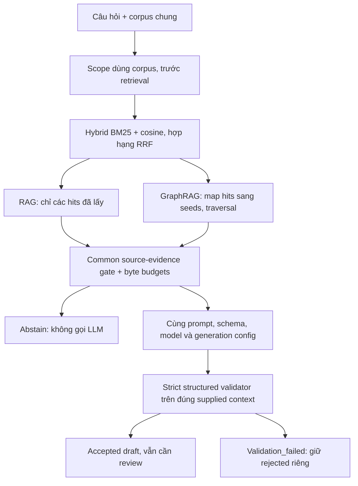

# Kết quả thực nghiệm RAG–GraphRAG

**Mốc chốt: 27/10/2026. Bản nháp chương thực nghiệm, AI-assisted, chờ người dùng duyệt.**

Recheck gate là kiểm tra tái lập offline, không phải mở lại thực nghiệm. Hai lượt live bên dưới là kết quả hiện hành; không có bước pilot/full live mới bắt buộc. Công việc tiếp theo chỉ là demo saved outputs, duyệt cách diễn giải và tích hợp bản đồ án chính.

Tài liệu tổng hợp kết quả đã lưu tại [thư mục review](../outputs/review/rag_graphrag_combined_semantic_20261027/). Không phát sinh request LLM, chạy lại generation hoặc thay đổi runtime khi soạn tài liệu. Mốc chốt là cấu hình và các kết quả hiện có, không phải xác nhận mọi kết luận đúng hay hệ thống đạt điều kiện production. Human approval không được tự gán.

`PROJECT_CONTEXT.md` mô tả trạng thái lịch sử ngày 14/10/2026, khi LLM/UI chưa hoàn thành. Theo yêu cầu hiện tại, chương này mô tả implementation và hai lượt saved live đã được tổng hợp; giữ nguyên brief và lịch sử, không dùng trạng thái cũ để phủ nhận artifacts mới. Các mục tiêu của đề cương vẫn được đối chiếu riêng trong [danh sách trước khi nộp](EXPERIMENTAL_SUBMISSION_CHECKLIST.md).

## 1. Mục tiêu và phạm vi

Thực nghiệm khảo sát việc bổ sung graph expansion vào hybrid retrieval có thay đổi khả năng cung cấp bằng chứng, quyết định proceed/abstain và đầu ra của trợ lý Threat Hunting như thế nào. Cần tách bốn tầng đánh giá: retrieval/context, gate, câu trả lời/citation và vận hành/thời gian. Điểm qua structured validation không thay thế đánh giá ngữ nghĩa.

Nguồn là ba file OTRF Security Datasets/Mordor, cùng tri thức Sigma/MITRE được pin trong artifacts. Số records dưới đây là số liệu inspection/normalization lịch sử; chúng **không phải số bản ghi đưa vào mỗi prompt** và không được đếm lại trong lần tổng hợp này. Nguồn JSON: MSHTA [review_manifest.json](../outputs/review/mshta-ground-truth/review_manifest.json), `raw_records_examined/canonical_records_examined`; PurpleSharp và Regsvr32 là `review.notes` của [GT PurpleSharp](../outputs/review/live_llm_fixes/20261025/artifacts-v2/purplesharp-ad/scenario_ground_truth.json) và [GT Regsvr32](../outputs/review/live_llm_fixes/20261025/artifacts-v2/regsvr32-c2/scenario_ground_truth.json), ghi số canonical records đã đọc. Các số này cũng được tóm tắt trong `PROJECT_CONTEXT.md`.

| Nguồn log | Records lịch sử | Phạm vi thực sự của lượt so sánh |
|---|---:|---|
| `cmd_mshta_vbscript_execute_psh_2020-10-2202580804.json` | 1.127 | Core `cmd → mshta → powershell`, hai nhóm tạo tiến trình có các góc nhìn Security/Sysmon. Command launch không chứng minh `Get-Service sysmon` hoàn tất, output hay trạng thái dịch vụ. |
| `purplesharp_ad_playbook_I_2020-10-22042947.json` | 25.993 | **Launch slice** của PurpleSharp: parent, host, `/t`, providers và khử trùng quan sát. Không chứng minh password spraying, Kerberoasting hoặc mọi technique trong arguments đã thành công. |
| `empire_launcher_sct_regsvr32_2020-07-21232741.json` | 2.390 | Process/scriptlet HTTP và network slice được chọn. Endpoint không chứng minh HTTP hoàn tất, nội dung tải, mục đích C2 hay số bytes bị lấy đi. |

Số liệu và hashes của consumers thực tế nằm trong `artifacts` của hai [manifest pilot](../outputs/experiments/rag-graphrag-pilot-source-contract-02/manifest.json) và [manifest lượt còn lại](../outputs/experiments/rag-graphrag-remaining-source-contract-01/manifest.json). Review không thực hiện fresh audit toàn raw logs, Sigma hoặc STIX. Snapshot ATT&CK được brief pin ở v19.1; mapping từng case vẫn phải theo assessment đã lưu, không suy ra technique được xác nhận chỉ vì ID tồn tại trong snapshot. Ví dụ RG02 GraphRAG còn `candidate/not_assessed`, object chưa resolve trong context.

MSHTA có telemetry deletion/log clearing ngoài core; không được diễn giải giới hạn core thành toàn file không có các hành vi này. Cũng không tự sửa lệch timestamp Sysmon `UtcTime` so với `TimeCreated`.

## 2. Kiến trúc thực tế và kiểm soát phép so sánh

### 2.1. Luồng xử lý

Corpus, graph và vector index là các JSON artifacts được nạp cục bộ. Lượt so sánh này không dùng database service để truy xuất. GraphRAG thực tế là **hybrid RAG cộng exact seed mapping và bounded graph traversal**, không phải một mô hình sinh khác hay toàn bộ thuật toán có tên GraphRAG ở các công trình khác.

Luồng được đối chiếu với [harness](../src/threat_hunting/evaluation/experimental_comparison.py), [orchestrator](../src/threat_hunting/graphrag/orchestrator.py) và [evidence contract](../src/threat_hunting/evaluation/evidence_contract.py), đồng thời bind code hashes trong manifests. Không lấy endpoint SSE có câu trả lời dựng sẵn hoặc metric demo hardcode làm kết quả đo.

### 2.2. Phần dùng chung và phần khác biệt

| Thành phần | Thiết lập và ý nghĩa |
|---|---|
| Nguồn và retrieval | Cùng corpus/index theo scenario; BM25 và cosine hợp hạng bằng RRF; `top_k=5`, `candidate_k=20`. Scores là điểm xếp hạng, không phải xác suất đúng. |
| Embedding | Sentence Transformers `intfloat/multilingual-e5-small`, revision `614241f622f53c4eeff9890bdc4f31cfecc418b3`, dimension 384, L2/cosine; prefix `query: ` và `passage: `. Model cache cục bộ. |
| RAG | Chỉ nhận returned chunks và provenance; không có graph nodes/edges/traversal. Không bổ sung graph evidence qua generator hoặc validator. |
| GraphRAG | Từ cùng hybrid retrieval, map IDs/JSON pointers sang seeds, traversal `both`, depth 2, tối đa 100 nodes/200 edges. Giữ hits và thêm returned graph objects. |
| Scope | Cả hai dùng corpus-only anchors. Đây là lựa chọn của harness; production POST còn có graph anchors nên không được đồng nhất hai đường chạy. |
| LLM | Configured provider `generic_openai`, model `openrouter/gemma-4-31b-it`, temperature 0, output `max_tokens=2048`, timeout 120 giây. Không attestation được weights/upstream routing thực tế. |
| Prompt/schema/validation | Cùng prompt builder, report schema và `HallucinationGuardrail(strict=True)`. Validator chỉ nhận supplied context của chính nhánh đó. |
| Context budget | Chung trần 262.144 canonical UTF-8 bytes/context và 294.912 bytes/messages; vượt budget thì abstain, không tự cắt context. Đây không phải tokens hoặc wire bytes. |
| Execution | Tuần tự, tối đa một HTTP attempt/generated branch, harness không retry/fallback. Dừng khi authentication error hoặc 429. Không suy ra router/upstream cũng không retry. |

Nguồn thiết lập: [config đã dùng](../configs/evaluation/experimental_comparison_evidence.json), `model`/`limits`/`artifacts` của manifests; thông tin embedding ở vector indexes được các manifest pin. [Compatibility audit](../outputs/review/rag_graphrag_combined_semantic_20261027/compatibility_and_coverage.json) xác minh hai lượt cùng config, rubric và artifact hashes.

Corpus RAG đã chứa fact, relationship, evidence và assessment chunks từ nguồn có cấu trúc. Vì vậy baseline không phải RAG chỉ trên tài liệu văn bản thuần. Graph expansion còn làm tăng context size và khả năng có raw fields/structured assessment objects. Đây là khác biệt về lượng và cách biểu diễn bằng chứng cần công khai; không thể quy mọi chênh lệch kết quả cho khả năng suy luận của LLM.

### 2.3. Common evidence contract, gate và guardrail

Experimental gate `source-evidence-contract/v1` dùng chung yêu cầu theo loại câu hỏi: parent, actor-bound command, endpoint/event/provider, nhóm quan sát và giới hạn kết quả. Evidence units được chiếu từ **đúng chunks/nodes/edges đã trả về**, giữ source pointer, source references và provenance SHA. RAG không bị yêu cầu phải có graph topology và không được dựng topology giả. Một số yêu cầu vẫn đòi original/canonical fields, không chỉ summary text; phạm vi nhận diện query là hữu hạn.

Topical stage giữ nguyên policy thresholds; ví dụ minimum hits 1, top cosine 0,75 theo [policy đã pin](../configs/gate/two_stage_production_policy.json). Topology-based answerability cũ chỉ được lưu diagnostic trong hai lượt này; final evidence eligibility do common contract quyết định. Chuỗi `production_qualified` trong file policy cũ không xác lập rằng source contract hoặc nghiên cứu này đã được kiểm chứng độc lập.

**Common gate contract chưa làm mọi source representation đồng nhất cho guardrail.** Gate chấp nhận một số relationship text có provenance, trong khi structured attack step của guardrail cần raw creation fields. Tương tự, text/flat metadata có technique chưa chắc được assessment extractor nhận diện. Các khác biệt này giải thích một phần rejection, được giữ nguyên để phân tích thay vì sửa sau khi xem output.

Guardrail kiểm tra structured claims và sanitize bản kiểm tra; không chứng minh toàn bộ prose/verdict đúng. Raw text, pre-sanitize report và validation được giữ riêng. `accepted_draft`, `validation_failed`, `abstain`, `provider_error`, `rate_limited` và `fallback` là các outcomes khác nhau. Rejected hoặc fallback không trở thành câu trả lời LLM thành công.

## 3. Thiết kế thực nghiệm và khả năng gộp

Giữ nguyên benchmark [cases.json](../outputs/review/live_llm_functional_smoke/cases.json), SHA-256 `d5e54b9396e43ffdf4dcdf27989537bfe55d5186d6ab9074a661dece8435fad3`: 15 câu gồm 9 `answerable`, 3 `overreach`, 3 `out_of_scope`, mỗi câu chạy RAG và GraphRAG. Đây là **regression benchmark đã dùng khi sửa hệ thống**, không phải held-out hay independent validation. Expected labels/rubric không cấp cho generator hoặc runtime gate. Các conflict host lịch sử ở PS01/RG01 được giữ và đối chiếu corrected source, không ép đầu ra theo host sai.

| Batch | Case pairs | Planned branches | Recorded attempts | Vai trò |
|---|---|---:|---:|---|
| `rag-graphrag-pilot-source-contract-02` | PS02, RG03 | 4 | 4 | Pilot vận hành, chọn trước theo bằng chứng chung; không dùng để chọn nhánh thắng |
| `rag-graphrag-remaining-source-contract-01` | Các case còn lại, loại PS02/RG03 | 26 | 13 | Hoàn tất phần còn lại, giữ nguyên rubric/cấu hình |
| Tổng hợp | Đủ 15 case pairs | 30 | 17 | Không trùng, thiếu hoặc thay thế case |

Nguồn: `compatibility_and_coverage.json`, `results.csv` theo `batch`, `llm_http_attempts`; [combined_results.json](../outputs/review/rag_graphrag_combined_semantic_20261027/combined_results.json) giữ source directory và thứ tự thực tế. Hai batch tương thích model/config/rubric và các runtime artifacts. Khác biệt code duy nhất là reporting cap/warning, đã so AST với snapshot cũ để xác minh không đổi hành vi retrieval/generation/validation. Pilot hiển thị cap 30 do metadata cũ, effective cap là 4 từ manifest; lượt còn lại cap 26, gate chỉ cho 13 attempts. Không sửa artifacts gốc để che lịch sử này.

Gộp dùng cho phân tích có giữ batch/order, không coi là một lượt đồng thời. Mỗi generated branch chỉ có một output. Không dùng số liệu này để ước lượng biến thiên qua nhiều lần sinh.

## 4. Kết quả vận hành và gate

| Outcome | RAG | GraphRAG | Tổng |
|---|---:|---:|---:|
| Planned branches | 15 | 15 | 30 |
| Có raw generation/recorded attempts | 8 | 9 | 17 |
| Accepted draft | 5/15 | 8/15 | 13/30 |
| Validation_failed | 3/15 | 1/15 | 4/30 |
| Abstain, không LLM | 7/15 | 6/15 | 13/30 |
| Provider/rate-limit error | 0/8 attempts | 0/9 attempts | 0/17 attempts |
| Fallback (số ca) | 0 | 0 | 0 |
| Runtime error (số ca) | 0 | 0 | 0 |
| Structured acceptance trên generated pool | 5/8 | 8/9 | 13/17 |

Nguồn: [results.csv](../outputs/review/rag_graphrag_combined_semantic_20261027/results.csv), các cột `branch`, `outcome`, `llm_http_attempts`; [summary.json](../outputs/review/rag_graphrag_combined_semantic_20261027/summary.json), `rag|graphrag.outcomes`, `planned`, `recorded_llm_http_attempts`, `accepted_coverage`. Accepted coverage là tỷ lệ trả draft qua kiểm tra cấu trúc, **không phải accuracy**.

Review abstain không mặc định mọi rejection là đúng:

| Nhóm abstain | Nhánh | Nhận định dựa trên context/rubric đã lưu |
|---|---:|---|
| MS05, PS05, RG05 cả hai nhánh | 6 | Đúng out_of_scope, chặn trước retrieval. |
| MS03 cả hai nhánh | 2 | Label answerable nên là benchmark false abstain. Context có hai groups/bốn refs nhưng thiếu explicit core/conhost boundary để trả lời đầy đủ; không phải không có evidence. |
| PS04, RG04 cả hai nhánh | 4 | Overreach rubric cho phép abstain hoặc limited answer. Có cơ hội trả lời có giới hạn, nhưng thiếu explicit limit witnesses mà contract đòi. Không tự tính thành mandatory false abstain hoặc đúng tuyệt đối. |
| RG02 RAG | 1 | Summary có HTTP URL/port và arguments, thiếu actor-bound raw command fields. Benchmark false abstain; context-relative false-abstain candidate cần người dùng duyệt. |

Nguồn: `semantic_annotations.json` → `branches.<case_branch>.abstain_review/semantic_notes`, `results.csv.abstain_review` và `summary.json.abstain_review_counts`. Theo 9 answerable cases/nhánh: false abstain RAG 2/9, GraphRAG 1/9. Theo 3 unrelated cases/nhánh: false proceed 0/3 cả hai (`false_abstain_benchmark`, `false_proceed_unrelated` trong summary). Overreach không gán một expected path bắt buộc. Các tỷ lệ gate này cũng không phải độ đúng câu trả lời cuối.

## 5. Semantic review và citation support

Đọc raw outputs, messages/context, pre-sanitize values và checked validation; nối claim chính đến source objects, fields và raw references. Reviewer là Codex/AI; không tự ghi tên người dùng hoặc human approval. [Semantic review](../outputs/review/rag_graphrag_combined_semantic_20261027/semantic_review.md) có từng report; [source_audit.json](../outputs/review/rag_graphrag_combined_semantic_20261027/source_audit.json) có field/citation traces.

| Phạm vi AI-assisted review | RAG | GraphRAG | Giới hạn mẫu số |
|---|---:|---:|---|
| Factual anchors chính phù hợp supplied context | 8/8 | 9/9 | Raw generated drafts, **gồm cả rejected** |
| Đầy đủ cho factual anchors được hỏi | 8/8 | 9/9 | Không đánh giá mọi nhận định phụ bằng chỉ số này |
| Citation support cho claims chính | 8/8 | 9/9 | Tính theo report có claims chính được support; không phải số citation đúng / tổng mọi citation |
| Core-supported accepted drafts | 5/5 | 8/8 | Có selection bias của validation |
| Coverage của core-supported accepted drafts | 5/15 | 8/15 | Loại rejected/abstain khỏi successful answers |
| Whole-report chưa phát hiện vấn đề trong scope qua AI review | 1/8 generated | 1/9 generated | Chỉ MS04; cả hai vẫn chờ human review |
| Whole-report cần review vấn đề tồn đọng | 7/8 generated | 8/9 generated | Không tương đương số report sai |

Nguồn: `summary.json` → `core_factual_pass_generated`, `core_citation_supported_generated`, `core_factual_pass_accepted`, `delivered_core_supported_coverage`, `whole_report_ai_clean_generated`, `whole_report_needs_review_generated`; completeness từ `results.csv.completeness`. Trong accepted pool, chỉ 2/13 whole reports chưa phát hiện vấn đề trong scope; 11/13 còn điểm review. Không viết “semantic accuracy = 100%” từ tỷ lệ factual anchors 17/17. `exists_unverified` ở backend cũng không bị ghi đè thành human-verified citation.

### 5.1. Diễn giải đúng trạng thái 15/17

**15/17 là số report được AI đánh dấu còn điểm cần xem xét, không phải tỷ lệ trả lời sai.** Các trục sau có thể cùng xuất hiện trên một report; không cộng các hàng thành số lỗi độc lập.

| Trục xem xét | Điều đã xác minh hoặc chưa xác minh | Case liên quan |
|---|---|---|
| Lỗi/khác biệt contract đã tái dựng từ artifacts | Có bốn strict validation failures; biết chính xác pre-sanitize. Ba RAG failures thiếu guardrail-readable source fields/assessment shape; MS02 GraphRAG mismatch vocabulary confidence. Đây là vấn đề structured contract, không tự chứng minh factual answer sai. | MS01 RAG, MS02 cả hai, RG01 RAG |
| Metadata sai đã xác minh | Pilot displayed cap 30 khác effective cap 4; patch reporting-only đã có trước tổng hợp. Không phải 30 requests đã xảy ra. | Cấp batch, không gán thành lỗi semantic từng report |
| Nhận định chưa được bằng chứng hỗ trợ | `MALICIOUS` là positive security judgment vượt bằng chứng parent/launch đang hỏi; không được dùng làm attack truth. | PS01 GraphRAG, RG01 cả hai |
| Nhận định chưa được xác lập | `SUSPICIOUS` chưa có đánh giá verdict riêng được rubric/evidence chứng minh; không tự coi là sai hoặc đúng. “Máy chủ” cũng chưa được hostname chứng minh là server role. | 11 SUSPICIOUS reports; server wording ở PS01 cả hai |
| Wording/scope cần duyệt | MS02 GraphRAG dùng “thực hiện lệnh” nhưng có qualifier chưa xác minh kết quả. PS03 GraphRAG nói “chỉ khác provider” quá gọn dù sau đó ghi khác timestamp; verdict INSUFFICIENT có referent chưa rõ. Không đủ căn cứ gán completed-success claim hoặc false refusal. | MS02 GraphRAG, PS03 GraphRAG |
| Chưa duyệt, chưa phát hiện lỗi factual/citation chính | Arguments, endpoint, host/provenance chính phù hợp context; vẫn còn verdict chưa xác lập. Trạng thái pending không biến factual content này thành lỗi. | Ví dụ PS02 cả hai, RG03 cả hai, MS01 GraphRAG, RG02 GraphRAG |

Nguồn có thể lọc lại: `semantic_annotations.json.branches` với `raw_verdict`, `verdict_review`, `whole_report_review`, `semantic_notes`, `failure_analysis`; cùng các cột tương ứng trong `results.csv`. Có 11 `SUSPICIOUS`, 3 `MALICIOUS` và một `INSUFFICIENT_EVIDENCE` scope chưa rõ trong nhóm 15; hai MS04 còn lại cũng có human status pending nhưng AI whole-report review là `pass`. Vì vậy phải phân biệt “còn vấn đề AI cần người xem” với “chưa có human approval” — toàn bộ outputs đều chưa được phê duyệt bởi người dùng.

Chưa có metric human-scored accuracy toàn report hoặc exhaustive claim-level citation precision. Có thể trình bày các observation trên, không tự thay giá trị pending/null thành điểm tuyệt đối.

## 6. Phân tích các cặp tiêu biểu

Nguồn chung: [case_pairs.csv](../outputs/review/rag_graphrag_combined_semantic_20261027/case_pairs.csv), `semantic_annotations.json`, `source_audit.json` và [validation_failures.json](../outputs/review/rag_graphrag_combined_semantic_20261027/validation_failures.json). Các raw/source files giữ đường dẫn qua `results.csv.source_directory`.

### MS01 — factual answer đúng nhưng structured acceptance khác nhau

Câu hỏi parent trực tiếp của PowerShell. Hai nhánh đều xác định `mshta.exe → powershell.exe`, evidence refs `jsonl:line:30` và `398`. RAG có relationship/evidence text nhưng không có raw creation fields cho cited step; assessment T1218.005 hiện trong text/flat metadata nhưng thiếu structured `external_id` mà guardrail extractor cần. Kết quả RAG `validation_failed`, GraphRAG `accepted_draft` nhờ returned graph representation có fields. Cả hai raw verdict SUSPICIOUS còn cần review. Cặp này minh họa representation/validator gap, không chứng minh GraphRAG trả lời parent chính xác hơn.

### MS02 — cả hai bị reject, nguyên nhân khác nhau

Hai direct answers trích đúng source CommandLine `vbscript:Execute`, gọi `Wscript.Shell` để launch PowerShell với `-noexit -command Get-Service sysmon`. Không có JavaScript promotion. RAG step đầu có ref275/raw fields và pass, step sau chỉ cite relationship text nên fail; mapping cũng gặp flat assessment metadata gap.

GraphRAG có hai steps/Sigma support hợp lệ nhưng raw `confidence=candidate`, `evidence_support=supported_by_observed_behavior` trùng source. Validator yêu cầu confidence có giá trị `supported_by_observed_behavior`; issue ghi `assessment_promotion` dù assessment status vẫn candidate. Đây là confidence vocabulary mismatch thận trọng, không phải bằng chứng model nâng thành confirmed. Sanitizer đổi confidence/verdict trên checked copy; output vẫn rejected. Cả hai có pre-sanitize, không có unknown cần đoán. Prose “thực hiện lệnh” của GraphRAG còn cần duyệt scope, vì source chỉ chứng minh launch.

### RG01 — parent support và security verdict là hai câu hỏi khác nhau

Hai nhánh trả đúng `powershell.exe → regsvr32.exe`, host `WORKSTATION5.mordor.local`. RAG cite source summary, thiếu raw creation fields nên structured step bị loại; GraphRAG có raw fields nên accepted. Source fact/observation chứa Sysmon ref97, Security ref219; citation bindings phải xem đúng context từng nhánh, không bổ sung raw fields cho RAG từ nguồn ngoài retrieval. Raw `MALICIOUS` của cả hai chưa được parent/launch slice hỗ trợ. Không đếm GraphRAG accepted như một verdict an ninh đã được chứng minh.

### RG02 — abstain không đồng nghĩa summary không có câu trả lời

RAG đã lấy summary chứa `http://10.10.10.5:8444/launcher.sct`, `/n` và `scrobj.dll`, nhưng contract đòi actor-bound command fields chưa returned nên abstain. Đây là benchmark false abstain và candidate false abstain nếu chấm theo khả năng trả từ summary; human review cần quyết định giới hạn đó. GraphRAG có raw command witness và trả accepted draft đúng HTTP/8444, không UNC/missing-`/n` anomaly. Không xác nhận payload completion/C2 purpose; T1218.010 vẫn candidate/not_assessed trong nguồn. Chênh lệch này nằm ở context và evidence granularity, không cho phép so chất lượng hai câu trả lời vì RAG không generation.

## 7. Timing và context size

| Đại lượng | RAG | GraphRAG |
|---|---:|---:|
| Generated samples | 8 | 9 |
| Generation + validation, mean / median (giây) | 11,166 / 11,276 | 12,418 / 11,576 |
| Generation + validation, min–max (giây) | 4,906–18,728 | 9,206–19,789 |
| Generated end-to-end mean (giây) | 11,306 | 12,592 |
| Abstain end-to-end mean (giây), mẫu riêng | 0,0666; n=7 | 0,0788; n=6 |
| Canonical context bytes mean, generated samples | 16.086,5 | 68.582,4 |
| Messages bytes mean, generated samples | 21.792,0 | 57.372,4 |

Nguồn: `summary.json` → `generation_plus_validation_seconds`, `generated_end_to_end_seconds`, `abstain_end_to_end_seconds`, `context_bytes_generated`, `messages_bytes_generated`; từng row trong [paired_details.csv](../outputs/review/rag_graphrag_combined_semantic_20261027/paired_details.csv). Trường saved `generation_validation_seconds` gồm provider call, parse/guardrail và ghi artifacts, **không có timer pure provider-call**. End-to-end còn gồm local retrieval/gate và các bước trước đó; warmup embedding báo riêng. Abstain không có LLM duration, không điền 0 rồi trộn vào mean generation.

Trên 8 câu có generation cả hai nhánh, mean generation+validation là RAG 11,166 giây, GraphRAG 12,413 giây; mean Graph−RAG 1,247 giây ([paired_timing.json](../outputs/review/rag_graphrag_combined_semantic_20261027/paired_timing.json)). Đây là thống kê mô tả các cặp, không kết luận tốc độ vượt trội hoặc có ý nghĩa thống kê. Chỉ 5 pairs có accepted drafts cả hai, một case RG02 chỉ GraphRAG generation (`case_pairs.csv`).

Context hai nhánh cùng trần nhưng độ dài thực tế khác; GraphRAG thêm objects/có bản sao thông tin facts. [Prompt formatter](../src/threat_hunting/llm/prompt.py) dựng text/structured source từ returned chunks và traversal nodes/edges, không chép nguyên context envelope/seed diagnostics vào messages. Vì vậy context bytes và messages bytes là hai đại lượng khác nhau, không thể trừ để suy ra token usage. Byte counts không phải input tokens, wire payload size hay provider usage. Không thay budget sau khi xem kết quả để cân điểm. Hai batch, branch order và cache/warmup cũng giới hạn diễn giải timing.

## 8. Giới hạn và kết luận

Thực nghiệm cho thấy pipeline đã ghi nhận đủ tập case pairs, phân biệt abstain trước LLM với output bị validator reject, lưu bằng chứng và giá trị trước sanitize để phân tích lỗi. Các factual anchors và citations chính của raw generations phù hợp supplied context qua AI-assisted review. Graph expansion tăng lượng bằng chứng và khả năng có fields được guardrail nhận diện, nhưng cũng tạo context dài hơn.

Kết luận phù hợp số liệu là: **trên regression benchmark này, RAG có 5/15 và GraphRAG có 8/15 accepted drafts; chênh lệch chịu ảnh hưởng evidence representation và strict validator. Chưa đủ cơ sở kết luận GraphRAG sinh câu trả lời tốt hơn tổng quát.** Accepted drafts vẫn có verdict/prose cần duyệt. Rejected drafts không được tính thành successful answers dù factual core có thể đúng.

Giới hạn bắt buộc khi đưa vào đồ án:

- Bộ regression đã dùng để sửa hệ thống, không held-out/independent validation; source contract chỉ bao hữu hạn dạng câu hỏi.
- Mẫu nhỏ, một generation/branch/case, hai batch; không repeated trials hoặc kiểm định hơn-kém.
- Chỉ các slices nêu ở mục 1, đặc biệt PurpleSharp launch slice; không chứng minh toàn bộ password spraying/Kerberoasting hoặc chuỗi C2 thành công.
- AI-assisted review chưa thay human review; chưa đo toàn report accuracy, toàn bộ claim-level citation precision hoặc độ hữu ích với chuyên viên bằng user study.
- RAG có quan hệ trong corpus; GraphRAG có context lớn hơn và cấu trúc khác; source/validator gap là yếu tố nhiễu.
- Pure provider latency, token usage, upstream retries/weights và fresh full-raw audit không có trong bằng chứng hiện tại.

Không cần mở một vòng tune runtime để chốt chương này. Các điểm chưa đo được được công khai như giới hạn; hướng mở rộng và các kết luận cần duyệt nằm ở [checklist](EXPERIMENTAL_SUBMISSION_CHECKLIST.md). Demo dùng saved replay theo [hướng dẫn](EXPERIMENTAL_DEMO.md), không tạo thêm output để chọn hình đẹp.

## 9. Bản đồ truy vết số liệu

| Nội dung | Artifact / fields hoặc phép nhóm |
|---|---|
| Thiết lập, hashes, khả năng gộp | Hai `manifest.json`; `compatibility_and_coverage.json.checks`, `coverage`, `normalized_caps`; config và index được pin |
| Planned/outcomes/attempts theo nhánh, batch | `results.csv`: group `branch,batch,outcome`, sum `llm_http_attempts`; `summary.json` |
| Cặp câu hỏi và rubric category | `case_pairs.csv`: một row/case; benchmark cases SHA trong manifests |
| Factual/completeness/citation, whole report | `results.csv` và `semantic_annotations.json.branches.<case_branch>`; `summary.json` có numerator/denominator |
| Nhóm verdict 11/3/1 và 15 needs-review | Lọc generated annotations, group `raw_verdict`, đối chiếu `whole_report_review`; hai MS04 pass được tách |
| Bốn rejections | `validation_failures.json`; source directories chứa raw text, pre-sanitize và validation |
| Abstain/FN/FP | `results.csv.abstain_review`, `summary.json.false_abstain_benchmark/false_proceed_unrelated`; không ép overreach thành nhãn bắt buộc |
| Thời gian/bytes, paired samples | `paired_details.csv`, `paired_timing.json`, các thống kê có n trong `summary.json` |
| Claims đối chiếu field/ref | `source_audit.json`, `semantic_review.md`; không lấy ID existence làm đủ support |
| Số records nguồn lịch sử | MSHTA `review_manifest.json.raw_records_examined/canonical_records_examined`; PurpleSharp/Regsvr32 GT `review.notes` về toàn canonical input; các đường dẫn đã dẫn ở mục 1 |
| Toàn vẹn artifacts | `input_integrity.json`, `integrity.json`, `artifact_hashes.json` trong review tổng hợp; manifest chốt tài liệu lưu riêng |

Mọi đường dẫn không ghi đầy đủ trong bảng trên nằm trong `outputs/review/rag_graphrag_combined_semantic_20261027/`. Counts của nguồn lịch sử không trộn với mẫu số evaluation. Có thể dùng lệnh aggregate **offline** đã lưu trong `report.md` nếu cần tái tạo bảng ở thư mục mới; không cần chạy lại cho mốc tài liệu này.
